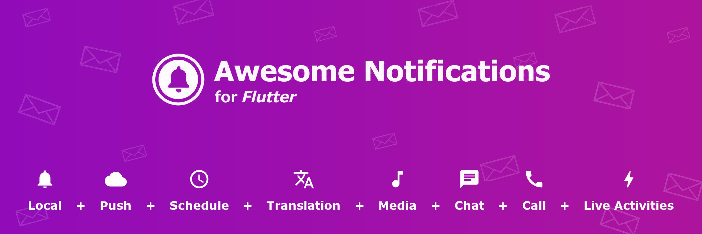
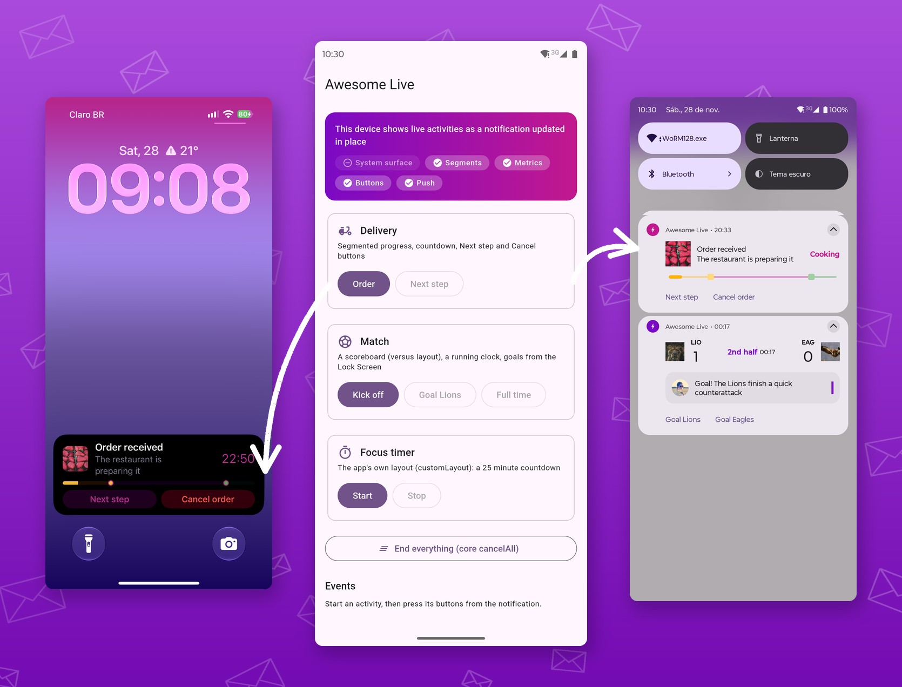

#  awesome_notifications_live_activities



Live activities for [awesome_notifications](https://pub.dev/packages/awesome_notifications): glanceable activities that update in
place (a delivery, a ride, a match, a timer) on **Android, iOS, macOS, Windows, Linux
and the Web**, from one model.

[](#)
[](#)
[](https://discord.awesome-notifications.carda.me)

[](#)
[](https://pub.dev/packages/awesome_notifications_live_activities)




*A delivery started in the example app (center): an iOS Live Activity on the lock screen (left)
and notifications updated in place on Android, with a match scoreboard (right).*

<br>

### **Key Features:**

* **iOS Live Activities** on the Lock Screen, the Dynamic Island, StandBy, CarPlay and
  the Apple Watch Smart Stack, drawn by a widget this package ships: **you write no
  SwiftUI**.
* **Android Live Updates** (Android 16+): the promoted notification with a chip in the
  status bar and on the Always-On Display, with a segmented progress bar.
* **The same activity everywhere else:** on older Android, an ongoing notification the
  package draws like a Live Update (segmented bar, metrics, short text, clock); a
  notification updated in place, silently, on macOS, Windows (with a native progress
  bar), Linux and the Web.
* **Progress with segments and points**, a **clock the system runs by itself**
  (countdown or elapsed), up to **three metrics**, a **short status text**, an image and
  **buttons** that reach `onActionReceivedMethod` like any notification button.
* **Your own layout** when you need one: an Android layout resource the package
  fills, and your own SwiftUI on iOS, reusing the package's views.
* **Push:** iOS push-to-start and update tokens (and iOS 18 broadcast channels);
  FCM data pushes everywhere else.

<br>

# 📙 Table of Contents

- [📱 Platform support](#-platform-support)
- [🛠 Getting started](#-getting-started)
  - [🍎 Configuring iOS](#-configuring-ios)
  - [🤖 Configuring Android](#-configuring-android)
  - [🖥 macOS, Windows, Linux and Web](#-macos-windows-linux-and-web)
- [⏱ Showing a live activity](#-showing-a-live-activity)
  - [Updating and ending it](#updating-and-ending-it)
  - [Buttons](#buttons)
  - [Status, permission and capabilities](#status-permission-and-capabilities)
  - [Your own layout (customLayout)](#your-own-layout-customlayout)
- [📨 Live activities by push](#-live-activities-by-push)
- [🔍 How it works on each platform](#-how-it-works-on-each-platform)
- [🏗 Model reference](#-model-reference)
- [🩺 Troubleshooting](#-troubleshooting)

<br>

# 📱 Platform support

| Platform | What the user sees | Minimum |
|---|---|---|
| iOS 16.1+ | Live Activity: Lock Screen, Dynamic Island, StandBy, CarPlay, Apple Watch | iOS 16.1 (buttons 17, push-to-start 17.2, broadcast channels 18) |
| iOS 15 – 16.0 | Notification replaced in place, silent after the first | iOS 15 |
| Android 16+ | Live Update: promoted ongoing notification, status bar chip | API 36 |
| Android < 16 | Ongoing notification drawn like a Live Update: segmented bar, short text, metrics, running clock (no status bar chip) | API 21 |
| macOS | Notification replaced in place, silent after the first | macOS 12 |
| Windows | Toast with a native progress bar, updated without popping up again | Windows 10 |
| Linux | Notification replaced in place, silent after the first | any notification server |
| Web | Notification replaced in place, silent after the first | browsers with notifications |

`AwesomeNotificationsLiveActivities().capabilities()` tells what the current device draws.

<br>

# 🛠 Getting started

```yaml
dependencies:
  awesome_notifications: ^1.0.0-dev.1
  awesome_notifications_live_activities: ^1.0.0-dev.1
```

Initialize the core as usual, with a channel for your activities. Nothing else is
needed in Dart: the package takes over every notification that carries a
`NotificationLiveActivity`, and leaves every other notification alone.

## 🍎 Configuring iOS

A Live Activity is drawn by a **Widget Extension**, a small second target of your app.
Xcode can't let a plugin add it for you, so you add it once; the widget itself comes
from this package. These steps use Flutter's Swift Package Manager support.

1. Turn on Swift Package Manager and let Flutter write the iOS project:
   ```bash
   flutter config --enable-swift-package-manager
   flutter build ios --config-only
   ```
2. Open `ios/Runner.xcworkspace`. **File → New → Target → Widget Extension**. Untick
   *Include Live Activity*, *Include Control* and *Include Configuration App Intent*.
   Set its deployment target to iOS 16.1 or later and the same Team as Runner.
3. Select the new target, **General → Frameworks and Libraries → + → Add Other → Add
   Package Dependency → Add Local…**, pick the folder
   `ios/Flutter/ephemeral/Packages/.packages/awesome_notifications_live_activities/AwesomeNotificationsLiveActivitiesWidget`
   and add its product **`AwesomeNotificationsLiveActivitiesWidget`** to the extension.
   (It is a small package of its own, with no dependencies, so it never needs Flutter or
   the core to resolve.)
4. Replace the extension's generated Swift files with one:
   ```swift
   import AwesomeNotificationsLiveActivitiesWidget
   import SwiftUI
   import WidgetKit

   @main
   struct LiveActivityWidgetBundle: WidgetBundle {
       var body: some Widget { AwnLiveActivityWidget() }
   }
   ```
   To draw some activities yourself, return your own widget instead (see
   [Your own layout](#your-own-layout-customlayout)).
5. Add the **App Groups** capability with the same group (for example
   `group.com.example.app`) to Runner and to the extension. The package copies your
   activity's images there, where the widget can read them.
6. In `ios/Runner/Info.plist`:
   ```xml
   <key>NSSupportsLiveActivities</key>
   <true/>
   <key>AwnLiveActivitiesAppGroup</key>
   <string>group.com.example.app</string>
   ```
   Add `NSSupportsLiveActivitiesFrequentUpdates` (`true`) if you update more than a few
   times an hour, and the **Push Notifications** capability to update them by push.
7. The extension must be embedded before Flutter's *Thin Binary* build phase (Xcode's
   template already does that; if you see a build cycle error, drag *Embed Foundation
   Extensions* above *Thin Binary* in Runner's Build Phases).

Without an App Group the activity still works, without its images (a warning is
logged). The example app in `example/ios` has all of this set up.

**Optional:** to handle a button pressed while the app is killed before Flutter starts,
call `AwesomeNotificationsLiveActivitiesPlugin.registerAtLaunch()` in your
`AppDelegate`'s `didFinishLaunchingWithOptions`.

## 🤖 Configuring Android

Nothing to configure. The package declares `POST_PROMOTED_NOTIFICATIONS`, the
permission Android 16 needs to show a Live Update. The user can turn Live Updates off
per app: `areEnabled()` tells, and `requestPermission()` opens the settings page.

The package uses `androidx.core` 1.17 (for `ProgressStyle`), so your app resolves that
version.

## 🖥 macOS, Windows, Linux and Web

Nothing to configure beyond the core.

<br>

# ⏱ Showing a live activity

Attach a `NotificationLiveActivity` to `createNotification`. The notification's
`title`, `body`, `progress` (0 to 100), `largeIcon`, `payload` and `actionButtons` are
part of the activity.

```dart
await AwesomeNotifications().createNotification(
  content: NotificationContent(
    id: 400,
    channelKey: 'live_activities',
    title: 'On the way',
    body: 'Your courier is riding to you',
    progress: 60,
    largeIcon: 'https://example.com/courier.jpg',
    payload: {'order': '42'},
  ),
  actionButtons: [
    NotificationActionButton(
      key: 'CANCEL',
      label: 'Cancel order',
      actionType: ActionType.SilentAction,
      isDangerousOption: true,
      autoDismissible: false,
    ),
  ],
  extensions: [
    NotificationLiveActivity(
      activityId: 'order-42',
      shortText: '10 min',
      accentColor: Colors.deepOrange,
      timer: LiveActivityTimer.countDown(
        end: DateTime.now().add(const Duration(minutes: 10)),
      ),
      progress: const LiveActivityProgress(
        segments: [
          LiveActivitySegment(25, color: Colors.amber),
          LiveActivitySegment(60, color: Colors.deepOrange),
          LiveActivitySegment(15, color: Colors.green),
        ],
        points: [LiveActivityPoint(25), LiveActivityPoint(85)],
      ),
      metrics: const [LiveActivityMetric(label: 'Stops', value: '2')],
    ),
  ],
);
```

* **`activityId`** stays the same across updates and pushes (the notification id when
  left out). It is added to the payload, so every action tells which activity it came
  from: `AwesomeNotificationsLiveActivities.activityIdOf(action)`.
* **`shortText`** is the few characters shown where space is tightest: Android's status
  bar chip, iOS's compact Dynamic Island.
* **`timer`** runs by itself: no update is needed to keep a countdown or a stopwatch
  current.
* A schedule is refused (`INVALID_ARGUMENTS`): a live activity starts now.

### A scoreboard: the versus layout

`layout: LiveActivityLayout.versus` draws two sides facing each other: the first
metric on the left and the second on the right, each with its `image` (a team's
logo), its label and its value in large type; `shortText` and the clock in the
middle; and the body (the latest play) below, beside the large icon, with the
accent color as a bar. It needs exactly two metrics.

```dart
NotificationLiveActivity(
  layout: LiveActivityLayout.versus,
  metrics: const [
    LiveActivityMetric(label: 'LIO', value: '1', image: 'https://example.com/lions.png'),
    LiveActivityMetric(label: 'EAG', value: '0', image: 'https://example.com/eagles.png'),
  ],
  shortText: '2nd half',
  timer: LiveActivityTimer.elapsed(start: kickOff),
)
```

The iOS widget (Lock Screen and Dynamic Island, with each side's logo and score in
the compact island) and Android's own layout draw the scoreboard. Android 16's Live
Update can't hold a layout of its own: as a Live Update it shows the score as its
status bar chip (`1–0`) and the line `LIO 1 – 0 EAG · 2nd half` above the body. Set
`androidLiveUpdate: false` to draw the scoreboard on Android 16+ too (see below). The
other platforms show the metrics as text, as in the standard layout.

### Android 16+: Live Update or the package's layout

`androidLiveUpdate` (default `true`) chooses how Android 16+ shows the activity:

| | `true`: Live Update | `false`: the package's layout |
|---|---|---|
| Drawn by | the system's styles (`ProgressStyle`, text) | the package's layout, as before Android 16 (the versus scoreboard included) |
| Status bar chip | yes (`shortText`, or the versus score) | no |
| Top of the shade, Lock Screen | promoted | an ongoing notification among the others |

Android only promotes notifications drawn with its own styles, so it is one or the
other. Before Android 16 the package's layout is always used.

## Updating and ending it

Send it again with the **same notification id**: it changes in place, silently. Set
`alert: true` on an update that should sound and show a banner (a goal, a delivery).

It ends when you send it with `state: LiveActivityState.ended` (it shows its final
content), when you call `AwesomeNotificationsLiveActivities().end(activityId)`, or
when the core cancels or dismisses its notification (any of `cancel`, `dismiss`,
`cancelAll`…). `dismissal` says how long an ended activity stays:

| `dismissal` | iOS | Elsewhere |
|---|---|---|
| `LiveActivityDismissal.system` (default) | Up to 4 hours on the Lock Screen | Stays until the user removes it |
| `LiveActivityDismissal.immediate` | Removed now | Removed now |
| `LiveActivityDismissal.at(date)` | Removed then (at most 4 hours) | Removed then |

`staleAt` marks an activity as out of date on iOS; elsewhere its notification is
removed at that time.

## Buttons

`actionButtons` become the activity's buttons (iOS 17+ and every other platform) and
arrive in `onActionReceivedMethod` exactly like notification buttons. Keep their state
in the payload, so a button pressed with the app killed knows what to send next:

```dart
@pragma('vm:entry-point')
static Future<void> onActionReceivedMethod(ReceivedAction action) async {
  if (action.buttonKeyPressed == 'CANCEL') {
    await AwesomeNotificationsLiveActivities().end(
      AwesomeNotificationsLiveActivities.activityIdOf(action)!,
      dismissal: LiveActivityDismissal.immediate,
    );
  }
}
```

A button keeps the core's `autoDismissible` behavior: left at `true`, pressing it
dismisses the notification and so ends the activity. Use `autoDismissible: false` for
buttons that should keep it going.

## Status, permission and capabilities

```dart
final live = AwesomeNotificationsLiveActivities();

live.onStatusChanged.listen((a) => print('${a.activityId}: ${a.status}')); // ended, dismissed…
final shown = await live.activities();       // what the system shows now
final enabled = await live.areEnabled();     // the user allows live activities
await live.requestPermission();              // opens the settings page (iOS, Android 16+)
final caps = await live.capabilities();      // what this device draws (below)
```

`capabilities()` tells what the current device draws, so the app can adapt its content
(for example, put the metrics in the body where they have no layout of their own):

| Capability | It means | iOS 16.1+ | Android 16+ | Android < 16 | macOS, Windows, Linux | Web |
|---|---|:-:|:-:|:-:|:-:|:-:|
| `systemSurface` | The activity has a surface of its own, beyond the notification list: iOS's Lock Screen and Dynamic Island, Android 16's Live Update (status bar chip, top of the shade, Lock Screen). Without it, the activity is a notification updated in place. | ✅ | ✅ | ❌ | ❌ | ❌ |
| `progressSegments` | The progress bar draws its segments in their colors, its points and its icons. Without it, a plain bar (or a text line `▰▰▰▱▱ 60%`). | ✅ | ✅ | ✅ | ❌ | ❌ |
| `metrics` | The metrics get a layout of their own (columns, the versus scoreboard). Without it, they are a text line in the body (`Speed 42 km/h · Stops 2`). | ✅ | ❌ ¹ | ✅ | ❌ | ❌ |
| `buttons` | The activity shows the notification's action buttons, which reach `onActionReceivedMethod`. | iOS 17+ | ✅ | ✅ | ✅ | ❌ |
| `push` | Activities can start and update by push with the app killed (iOS: ActivityKit pushes; Android: FCM data pushes). | ✅ | ✅ | ✅ | ❌ | ❌ |

¹ As a Live Update. With `androidLiveUpdate: false` (or a `customLayout`), Android 16+
draws them like Android < 16.

The example app shows them as chips on its status card.

## Your own layout (customLayout)

The package's layouts (standard and versus) need no native code. When an activity needs a
look of its own, name a layout of your app with `customLayout`: on Android it is a
layout resource the package fills; on iOS your widget extension draws it. The name is a
resource name (lowercase letters, digits and `_`). The other platforms ignore it and show
the activity as text.

```dart
NotificationLiveActivity(
  activityId: 'focus',
  customLayout: 'focus_timer',
  timer: LiveActivityTimer.countDown(start: start, end: end),
)
```

The example app's focus timer does this on both platforms.

### 🤖 Android: a layout resource

1. Create `android/app/src/main/res/layout/focus_timer.xml` (the collapsed view) and,
   optionally, `focus_timer_expanded.xml` (the expanded view; without it, the
   collapsed one is used expanded too). Use only the views notifications allow
   (`LinearLayout`, `FrameLayout`, `RelativeLayout`, `TextView`, `ImageView`,
   `Chronometer`, `ProgressBar`…).
2. Give the views the package should fill one of these ids (reference them with
   `@id/`, not `@+id/`: the package declares them). Any id the layout doesn't have is
   skipped; a text view whose text is empty is hidden.

   | View id | View | Filled with |
   |---|---|---|
   | `awn_live_title` | `TextView` | The notification's `title` (HTML as the core draws it) |
   | `awn_live_body` | `TextView` | The notification's `body` |
   | `awn_live_short` | `TextView` | `shortText`, in `accentColor` |
   | `awn_live_clock` | `Chronometer` | The `timer`, run by the system (counting down or up); hidden without a timer or once ended |
   | `awn_live_bar` | `ImageView` | The progress bar, drawn with its segments and points |
   | `awn_live_image` | `ImageView` | The notification's `largeIcon` |
   | `awn_live_accent` | any view | `accentColor` as its background |
   | `awn_live_metric_value_0` … `_2` | `TextView` | Each metric's `value` and `unit` |
   | `awn_live_metric_label_0` … `_2` | `TextView` | Each metric's `label` |
   | `awn_live_metric_image_0` … `_2` | `ImageView` | Each metric's `image` |

   ```xml
   <LinearLayout xmlns:android="http://schemas.android.com/apk/res/android"
       android:layout_width="match_parent"
       android:layout_height="wrap_content"
       android:gravity="center_vertical"
       android:orientation="horizontal">

       <LinearLayout
           android:layout_width="0dp"
           android:layout_height="wrap_content"
           android:layout_weight="1"
           android:orientation="vertical">

           <TextView
               android:id="@id/awn_live_title"
               style="@style/TextAppearance.Compat.Notification.Title"
               android:layout_width="wrap_content"
               android:layout_height="wrap_content" />

           <TextView
               android:id="@id/awn_live_body"
               style="@style/TextAppearance.Compat.Notification"
               android:layout_width="wrap_content"
               android:layout_height="wrap_content" />
       </LinearLayout>

       <Chronometer
           android:id="@id/awn_live_clock"
           style="@style/TextAppearance.Compat.Notification.Title"
           android:layout_width="wrap_content"
           android:layout_height="wrap_content"
           android:textSize="32sp"
           android:visibility="gone" />
   </LinearLayout>
   ```
3. Keep the layout in release builds: it is referenced only by name, so the resource
   shrinker would drop it. In `android/app/src/main/res/raw/keep.xml`:
   ```xml
   <resources xmlns:tools="http://schemas.android.com/tools"
       tools:keep="@layout/focus_timer,@layout/focus_timer_expanded" />
   ```

The system keeps its header (the app's name and icon) and the buttons around the layout.
A custom layout is never a Live Update: Android 16+ only promotes notifications drawn
with its own styles, so it shows as an ongoing notification, with no status bar chip. A
`customLayout` the app doesn't have is refused (`INVALID_ARGUMENTS`).

### 🍎 iOS: your own widget

On iOS every activity is drawn by the Widget Extension. Instead of returning
`AwnLiveActivityWidget()`, return a widget of your own for `AwnLiveActivityAttributes`:
draw the activities whose `customLayout` you know, and hand the others to the
package's views.

```swift
import ActivityKit
import AwesomeNotificationsLiveActivitiesWidget
import SwiftUI
import WidgetKit

@main
struct LiveActivityWidgetBundle: WidgetBundle {
    var body: some Widget { LiveActivityWidget() }
}

struct LiveActivityWidget: Widget {
    var body: some WidgetConfiguration {
        ActivityConfiguration(for: AwnLiveActivityAttributes.self) { context in
            // The Lock Screen (and StandBy, CarPlay, the Apple Watch).
            if context.state.customLayout == "focus_timer" {
                FocusTimerView(context: context)
            } else {
                AwnLiveActivityWidget.lockScreen(context)
            }
        } dynamicIsland: { context in
            // Your own DynamicIsland { … } for your layouts, or the package's.
            AwnLiveActivityWidget.dynamicIsland(context)
        }
    }
}

struct FocusTimerView: View {
    let context: ActivityViewContext<AwnLiveActivityAttributes>

    var body: some View {
        let state = context.state
        VStack(spacing: 12) {
            HStack {
                VStack(alignment: .leading) {
                    Text(state.title ?? "").font(.headline)
                    Text(state.body ?? "").font(.subheadline).foregroundColor(.secondary)
                }
                Spacer()
                if let timer = AwnTimerText(state: state) {
                    timer.font(.system(size: 40, weight: .medium).monospacedDigit())
                        .multilineTextAlignment(.trailing)
                        .frame(maxWidth: 140, alignment: .trailing)
                }
            }
            AwnButtonsView(attributes: context.attributes, state: state, compact: true)
        }
        .padding(16)
        .activitySystemActionForegroundColor(AwnColors.accent(state))
    }
}
```

What your views can read:

| | What it is |
|---|---|
| `context.attributes.activityId` | The activity's id |
| `context.state.customLayout` | The layout name the app sent |
| `context.state.title`, `.body` | The notification's title and body |
| `context.state.shortText` | `shortText` |
| `context.state.progress`, `.fraction` | The progress, 0 to 100 and 0 to 1 (nil: indeterminate) |
| `context.state.segments`, `.points` | The progress bar's segments and points |
| `context.state.metrics` | The metrics: `label`, `value`, `unit`, `image` |
| `context.state.timerStartDate`, `.timerEndDate`, `.countDown` | The timer |
| `context.state.accentColor` | The accent color (ARGB); `AwnColors.accent(state)` as a `Color` |
| `context.state.largeIcon` | The large icon's image name |
| `context.state.buttons` | The notification's buttons |
| `context.state.ended` | The activity is over (its final content) |

And the package's pieces you can reuse in your views:

| | What it draws |
|---|---|
| `AwnLiveActivityWidget.lockScreen(context)` | The package's Lock Screen view of the activity |
| `AwnLiveActivityWidget.dynamicIsland(context)` | The package's Dynamic Island of the activity |
| `AwnImage(name:appGroup:)` | An image of the activity (`state.largeIcon`, a metric's `image`, the progress icons), with `appGroup: context.attributes.appGroup` |
| `AwnTimerText(state:)` | The timer, run by the system (nil without one) |
| `AwnProgressView(attributes:state:)` | The progress bar with its segments and points |
| `AwnButtonsView(attributes:state:compact:)` | The buttons (iOS 17+), which reach `onActionReceivedMethod` |
| `AwnColors.accent(state)` | The accent color |

The Lock Screen gives an activity at most 160 points of height; larger content is cut.

<br>

# 📨 Live activities by push

**Android, macOS, Windows, Linux, Web:** send an FCM data message with the notification
and its `liveActivity` block (see the core's push documentation); the same id updates
it.

**iOS:** ActivityKit pushes go to Apple directly, never through your app:

* **Start** (iOS 17.2+): send to the **push-to-start token**
  (`onPushToStartToken` / `pushToStartToken()`).
* **Update / end:** send to the activity's **push token** (`onPushToken` /
  `pushToken(activityId)`), or, on iOS 18+, to its **broadcast channel** (`pushChannel`).

The payload's `content-state` uses the package's field names:

```bash
curl -v \
  --header "apns-topic: com.example.app.push-type.liveactivity" \
  --header "apns-push-type: liveactivity" \
  --header "apns-priority: 10" \
  --header "authorization: bearer $JWT" \
  --data '{
    "aps": {
      "timestamp": '"$(date +%s)"',
      "event": "update",
      "content-state": {
        "title": "Almost there",
        "body": "Your courier is around the corner",
        "progress": 88,
        "shortText": "2 min",
        "timerEnd": 1795700000000,
        "countDown": true,
        "metrics": [{"label": "Stops", "value": "0"}],
        "ended": false
      }
    }
  }' \
  --http2 https://api.push.apple.com/3/device/$ACTIVITY_PUSH_TOKEN
```

A push-to-start sends `"event": "start"` with `"attributes-type": "AwnLiveActivityAttributes"`
and `"attributes": {"activityId": "order-42", "appGroup": "group.com.example.app"}`;
`"event": "end"` takes an optional `"dismissal-date"`. FCM's HTTP v1 API can carry the
same payload with `apns.live_activity_token`. Activities started by push are picked up
when the app runs (`activities()`, `end`, status events).

<br>

# 🔍 How it works on each platform

* **iOS 16.1+:** no notification is posted. ActivityKit starts, updates and ends the
  activity; the package's widget draws it. Images are scaled to 256 px and stored once
  in the App Group. The whole state must fit in 4 KB (iOS's limit): larger is refused.
  If iOS refuses to start it (the user turned Live Activities off), the package shows a
  notification instead.
* **Android 16+** (`androidLiveUpdate`, the default): a `ProgressStyle` notification that asks to be promoted, with
  `shortText` as its status bar chip, ongoing while active and alerting only once.
  Promoted notifications can't be colorized, so `backgroundColor` is ignored.
* **Android < 16, or `androidLiveUpdate: false`:** an ongoing notification, alerting only once, with the package's own
  layout inside the system's decorated notification (which keeps the header and the
  buttons): the title with the running clock and `shortText`, the segmented bar with its
  points (solid up to the progress, faded after it), and, expanded, the image, the body
  and the metrics in columns. There is no status bar chip before Android 16.
* **macOS, iOS < 16.1, Linux, Web:** the notification is replaced in place, with sound
  only on the first post or with `alert`. The text adds a progress line
  (`▰▰▰▰▰▰▱▱▱▱ 60% · 10 min`), the clock (`Ends at 17:30`) and the metrics.
* **Windows:** a toast with a native progress bar, updated through Windows' data
  binding so updates don't pop up again.

<br>

# 🏗 Model reference

| Field | Type | Default | Notes |
|---|---|---|---|
| `activityId` | `String?` | notification id | Stable across updates and pushes |
| `state` | `LiveActivityState` | `active` | `ended` ends it |
| `progress` | `LiveActivityProgress?` | — | `segments`, `points`, `trackerIcon`, `startIcon`, `endIcon`; the value is `content.progress` |
| `timer` | `LiveActivityTimer?` | — | `.countDown(end:, start:)` or `.elapsed(start:)` |
| `metrics` | `List<LiveActivityMetric>` | `[]` | Up to 3: `label`, `value`, `unit`, `image` (versus) |
| `layout` | `LiveActivityLayout` | `standard` | `versus`: a scoreboard of exactly 2 metrics |
| `shortText` | `String?` | — | Status bar chip / compact Dynamic Island |
| `accentColor` | `Color?` | — | Progress and icons |
| `staleAt` | `DateTime?` | — | iOS: stale; elsewhere: removed |
| `relevance` | `double?` | — | iOS: order among activities |
| `alert` | `bool` | `false` | This update sounds |
| `dismissal` | `LiveActivityDismissal` | `system` | When an ended activity goes away |
| `pushChannel` | `String?` | — | iOS 18+ broadcast channel |
| `androidLiveUpdate` | `bool` | `true` | Android 16+: a Live Update; `false`: the package's own layout (no chip) |
| `customLayout` | `String?` | — | The app's own layout: Android `res/layout/<name>.xml`, iOS your widget |

<br>

# 🩺 Troubleshooting

* **iOS: nothing shows.** Check `areEnabled()` (Settings → your app → Live
  Activities), `NSSupportsLiveActivities` in Runner's Info.plist, and that the Widget
  Extension is embedded in the app.
* **iOS: "Provisioning profile doesn't include the App Groups capability"** (or *No
  Accounts*) on a real device. The wildcard profile can't hold an App Group: sign in to
  your team in Xcode (Settings → Accounts) and keep *Automatically manage signing* on, in
  Runner and in the extension, so Xcode registers both App IDs and the group. From the
  command line, `xcodebuild ... -allowProvisioningUpdates DEVELOPMENT_TEAM=<your team>`
  does the same.
* **iOS: no images.** Runner and the extension need the same App Group, and
  `AwnLiveActivitiesAppGroup` must name it.
* **iOS: the first button press after installing is lost.** iOS is still indexing the
  app's intents; later presses work.
* **Android 16: no status bar chip.** The chip shows only while your app is in the
  background, and only if `areEnabled()` is true.
* **Android: a `customLayout` works in debug but is refused in release.** The resource
  shrinker dropped the layout: keep it in `res/raw/keep.xml` (see above).
* **`INVALID_ARGUMENTS`:** more than 3 metrics, a versus layout without exactly 2, a
  `customLayout` the Android app doesn't have, an empty `activityId`/`shortText`, a
  point outside the segments, a countdown that ends before it starts, a schedule, or (iOS)
  a state over 4 KB.
