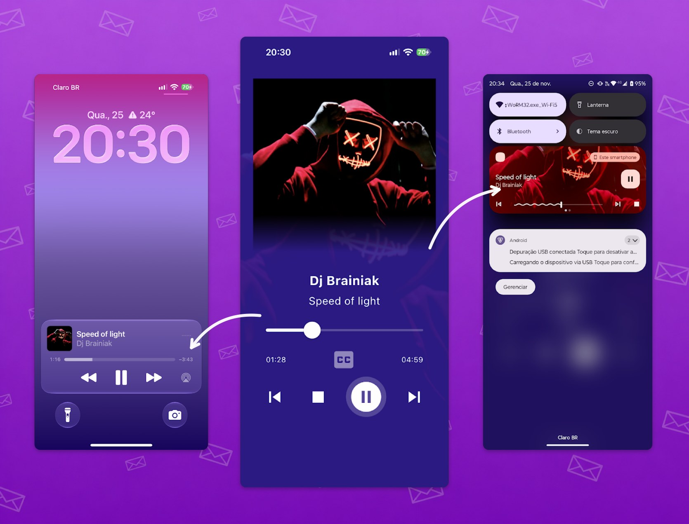

#  awesome_notifications_media


[](#)
[](#)
[](https://discord.awesome-notifications.carda.me)

[](#)
[](https://pub.dev/packages/awesome_notifications_media)


Media controls for [awesome_notifications](https://pub.dev/packages/awesome_notifications): the system's own media player for your
app, on **Android, iOS, macOS, Windows, Linux and the Web**, from one model.

**The package doesn't play audio:** your player (just_audio, audioplayers, your own)
plays; this package mirrors its state on the system controls and sends the user's
commands back to your app.



*The example app's player (center) and the same session on the iOS lock screen (left)
and in the Android Quick Settings (right).*

<br>

### **Key Features:**

* **The system's own media controls** on every platform, with the cover art, the
  track, the artist and a progress bar that advances by itself.
* **Standard controls drawn by the system:** play, pause, stop, previous / next
  track, skip back / forward by seconds, seek, fast forward and rewind.
* **Commands where you want them:** in `onActionReceivedMethod` (Android delivers
  them even with the app killed), in a stream, or both.
* **Position from the model or from your player's stream**, without re-sending the
  notification every second.
* **One model everywhere**, validated before it reaches the platform.

<br>
<br>

# 📙 Table of Contents

- [📱 Platform support](#-platform-support)
- [⚠️ Breaking change from 0.12](#️-breaking-change-from-012)
- [🛠 Getting started](#-getting-started)
  - [🤖 Configuring Android](#-configuring-android)
  - [🍎 Configuring iOS (required)](#-configuring-ios-required)
  - [🖥 Configuring macOS](#-configuring-macos)
  - [🪟 Windows, 🐧 Linux and 🌐 Web](#-windows--linux-and--web)
- [🎵 Showing what is playing](#-showing-what-is-playing)
  - [Controls](#controls)
  - [Receiving the commands](#receiving-the-commands)
  - [Keeping the position in step](#keeping-the-position-in-step)
  - [Stopping](#stopping)
- [⏳ Running in the background](#-running-in-the-background)
- [🔍 How it works on each platform](#-how-it-works-on-each-platform)
- [🏗 Model reference](#-model-reference)
- [🩺 Troubleshooting](#-troubleshooting)

<br>
<br>

# 📱 Platform support

| Feature | Android | iOS | macOS | Windows | Linux | Web |
|---|:-:|:-:|:-:|:-:|:-:|:-:|
| System media controls | ✅ media notification + Quick Settings | ✅ Now Playing | ✅ Now Playing | 🧪 media overlay | 🧪 MPRIS | 🧪 Media Session |
| Cover art | ✅ | ✅ | ✅ | 🧪 | ✅ | ✅ (http/asset only) |
| Progress bar / seek | ✅ (Android 10+) | ✅ | ✅ | 🧪 | ✅ | ✅ |
| Custom buttons (`actionButtons`) | ✅ | ❌ | ❌ | ❌ | ❌ | ❌ |
| Lock screen | ✅ | ✅ | ❌ | 🧪 | ❌ | ❌ |
| Commands with the app killed | ✅ | ❌ (see [background](#-running-in-the-background)) | ❌ | ❌ | ❌ | ❌ |

✅ supported · 🧪 preview (implemented, still being validated) · ⏳ planned · ❌ not possible on this platform

Use `AwesomeNotificationsMedia().capabilities()` to adapt your UI to what the current
platform shows.

<br>
<br>

# ⚠️ Breaking change from 0.12

With this package installed, the `NotificationLayout.MediaPlayer` layout **requires** a
`NotificationMedia` in `extensions`. A `MediaPlayer` notification without one fails with
`INVALID_ARGUMENTS` (`arguments.invalid.notificationMedia`) instead of showing the 0.12
layout. Without this package, the core keeps the 0.12 layout exactly as it was.

| 0.12 content field | With this package |
|---|---|
| `title` (artist / band) | `NotificationMedia.artist` |
| `body` (track) | `NotificationMedia.title` |
| `largeIcon` / `bigPicture` (cover) | `NotificationMedia.artwork` |
| `duration`, `progress` (0–100) | `duration`, `position` (a `Duration`) |
| `playState`, `playbackSpeed` | `state`, `playbackSpeed` |
| buttons `MEDIA_PLAY`, `MEDIA_NEXT`… with app icons | `controls: {MediaControl.play, MediaControl.skipNext, …}`, drawn by the system |
| actions in `onActionReceivedMethod` by button key | the same handler, read with `AwesomeNotificationsMedia.commandOf` |

Media models are also refused, with `INVALID_ARGUMENTS`, when they carry a
**schedule** (`arguments.invalid.notificationMedia.schedule`) or arrive by **push**
(`arguments.invalid.notificationMedia.push`): media controls mirror a player that is
playing now, in the app.

<br>
<br>

# 🛠 Getting started

1. Add the core and this package to your `pubspec.yaml`:

```yaml
dependencies:
  awesome_notifications: ^1.0.0-dev.1        # the core
  awesome_notifications_media: ^1.0.0-dev.1  # this package (same version line as the core)
```

2. Get the packages:

```bash
flutter pub get
```

3. Create a channel for the player (Android shows the media notification in it; keep it
   quiet):

```dart
NotificationChannel(
  channelKey: 'media_player',
  channelName: 'Media player',
  channelDescription: 'Media player controls',
  importance: NotificationImportance.Low,
  playSound: false,
  enableVibration: false,
)
```

<br>

## 🤖 Configuring Android

Nothing to add beyond the core's setup. To keep **playing** in the background, your
player needs a foreground service of type `mediaPlayback` (Android 14+: the
`FOREGROUND_SERVICE_MEDIA_PLAYBACK` permission); player packages such as audio_service
provide it. See [Running in the background](#-running-in-the-background).

<br>

## 🍎 Configuring iOS (required)

iOS shows Now Playing (lock screen, Control Center, Dynamic Island) only while your app
**plays audio** with an active audio session. Do these steps once per app:

**1. Enable background audio.** It is a capability declared in Xcode, not a permission:
the user is never asked.

1. Open `ios/Runner.xcworkspace`, select the **Runner** target, **Signing &
   Capabilities**.
2. Click **+ Capability** → **Background Modes** → check **Audio, AirPlay, and Picture
   in Picture**.

Xcode adds to `ios/Runner/Info.plist`:

```xml
<key>UIBackgroundModes</key>
<array>
    <string>audio</string>
</array>
```

Without it, iOS suspends your app a few seconds after it leaves the screen: the audio
stops, the Now Playing card goes away and the commands never arrive.

**2. Activate the audio session while playing,** with the `playback` category. Player
packages do it (just_audio through audio_session:
`AudioSession.instance.configure(const AudioSessionConfiguration.music())`).

> App Review rejects the audio background mode in an app that doesn't play audible
> content. (The example app plays a silent loop only to show Now Playing; a real app
> plays its own audio.)

<br>

## 🖥 Configuring macOS

Nothing required: macOS shows Now Playing without an audio session. To load an `https`
cover, keep `com.apple.security.network.client` in both
`macos/Runner/DebugProfile.entitlements` and `macos/Runner/Release.entitlements`.

<br>

## 🪟 Windows, 🐧 Linux and 🌐 Web

Nothing to configure.

- **Windows:** the controls belong to the app's window; `https` covers are downloaded
  to a temporary file first.
- **Linux:** the app becomes an MPRIS player on the session bus; GNOME, KDE and media
  keys pick it up.
- **Web:** browsers show the media session only while a media element of the page is
  playing; `file://` and `resource://` covers can't be loaded by a page.

<br>
<br>

# 🎵 Showing what is playing

A media player is a regular `createNotification` from the core with the `MediaPlayer`
layout and a `NotificationMedia` in `extensions`. Send it again (same id) on every
change of your player: play, pause, seek, next track. Between changes the system
advances the position by itself.

```dart
await AwesomeNotifications().createNotification(
  content: NotificationContent(
    id: 100,                                  // one id per player
    channelKey: 'media_player',
    notificationLayout: NotificationLayout.MediaPlayer,
  ),
  extensions: [
    NotificationMedia(
      sessionId: 'main-player',               // one system session per id
      title: 'Champagne Supernova',
      artist: 'Bright Sharp',
      album: 'Rock Disc',
      artwork: 'https://example.com/rock-disc.jpg',
      duration: const Duration(minutes: 4, seconds: 21),
      position: const Duration(seconds: 37),
      state: NotificationPlayState.playing,
      controls: {
        MediaControl.skipPrevious,
        MediaControl.pause,
        MediaControl.skipNext,
        MediaControl.seekTo,
      },
    ),
  ],
);
```

The content's `title` and `body` can stay empty: the package fills them with the
track and the artist.

<br>

## Controls

| `MediaControl` | What the user sees |
|---|---|
| `play`, `pause` | play / pause (show the one that fits the state) |
| `stop` | stop |
| `skipNext`, `skipPrevious` | next / previous **track** |
| `skipForward`, `skipBackward` | jump forward / back by `skipInterval` (default 15 s) |
| `seekTo` | a draggable progress bar |
| `fastForward`, `rewind` | fast forward / rewind |

iOS and macOS have one button slot on each side of play: when a model has both track
skips and second skips, the **track** buttons are shown. On Windows, second skips use
the fast forward / rewind buttons when those are not in the model.

<br>

## Receiving the commands

Each session chooses where its commands go with `commandTarget`:

| `MediaCommandTarget` | Where | With the app killed |
|---|---|---|
| `actionEvent` (default) | `onActionReceivedMethod` | ✅ Android (background isolate) |
| `stream` | `AwesomeNotificationsMedia().commands` | ❌ only while the app runs |
| `both` | both | as above |

In your action listener:

```dart
@pragma('vm:entry-point')
static Future<void> onActionReceivedMethod(ReceivedAction action) async {
  final command = AwesomeNotificationsMedia.commandOf(action);
  if (command == null) return; // not a media command
  switch (command.control) {
    case MediaControl.play: await player.play();
    case MediaControl.pause: await player.pause();
    case MediaControl.skipNext: await player.seekToNext();
    case MediaControl.seekTo: await player.seek(command.position);
    default: break;
  }
}
```

Or with the stream (`commandTarget: MediaCommandTarget.stream`):

```dart
AwesomeNotificationsMedia().commands.listen((command) {
  // command.control, command.sessionId, command.position (seekTo)
});
```

A command arrives as an action with `buttonKeyPressed` = `awn.media.<control>` (for
example `awn.media.pause`), the target position in milliseconds in `buttonKeyInput`
for a seek, and the session in the payload (`mediaSessionId`). It never dismisses the
media notification.

<br>

## Keeping the position in step

Two ways, pick one per session:

- **In the model** (the default): send `position` with each change. The system advances
  it while playing from the position, the speed and the time of the update.
- **From your player's stream:**

```dart
AwesomeNotificationsMedia().bindPosition('main-player', player.positionStream);
// …
AwesomeNotificationsMedia().unbindPosition('main-player');
```

`bindPosition` sends at most one update per second, and a jump (a seek) at once.

<br>

## Stopping

```dart
await AwesomeNotificationsMedia().stop('main-player');
```

`stop` releases the session and removes its controls everywhere. Cancelling or
dismissing the media notification through the core (`cancel`, `dismiss`, `cancelAll`,
by channel or group) ends its session the same way, playing or not.

On Android 11+ the user can't swipe a media notification away (the system pins it
while its session lives), and hiding the player in Quick Settings doesn't tell your
app: the session ends only through `stop` or the core's cancel / dismiss. Below
Android 11, a swipe-away ends it too.

<br>
<br>

# ⏳ Running in the background

A media app must keep running while it plays: the system controls only reach a process
that is alive, except on Android, where a command can start a killed app.

| Platform | App killed or suspended | What your app needs |
|---|---|---|
| Android | Commands still reach `onActionReceivedMethod`, in a background isolate | A foreground service of type `mediaPlayback` to keep playing (your player's job) |
| iOS | Without background audio, iOS suspends the app: audio stops, Now Playing goes away, commands never arrive. A force-quit app is never relaunched for a command | The **Audio** background mode and an active `playback` audio session ([setup](#-configuring-ios-required)) |
| macOS | Runs while open; once quit, Now Playing is removed | Nothing |
| Windows, Linux | Commands reach only a running app | Nothing |
| Web | Commands reach only an open page that plays media | A media element playing |

On **Android 13+**, when the system kills your app's process the media player
disappears from the shade and Quick Settings (its session died with the process), even
though the notification record remains; it comes back when your app posts again.

<br>
<br>

# 🔍 How it works on each platform

The same model and the same rules everywhere; what differs is what each system can
show.

- **Events:** a media notification fires the core's created and displayed events on
  every platform, like any other notification, so your listeners see it as usual.
- **Where it shows:** Android posts a real media notification; iOS, macOS, Windows,
  Linux and the Web show the system's media controls instead and post no notification.
- **Sessions:** Android keeps one system session per `sessionId`. The other platforms
  have one media player per app: the session updated last owns it, and stopping it
  clears it.
- **Refused models** (`INVALID_ARGUMENTS`):

| Detailed code | When |
|---|---|
| `arguments.invalid.notificationMedia` | `MediaPlayer` layout without a `NotificationMedia` |
| `arguments.invalid.notificationMedia.layout` | a `NotificationMedia` with another layout |
| `arguments.invalid.notificationMedia.schedule` | a media model with a schedule |
| `arguments.invalid.notificationMedia.push` | a media model that came by push |

- **Playback state** (`NotificationPlayState`) as each system knows it:

| State | Android | iOS / macOS (rate) | Windows | Linux (MPRIS) | Web |
|---|---|---|---|---|---|
| `playing`, `forwarding`, `rewinding` | playing / fast forwarding / rewinding | playing (speed) | Playing | Playing | playing |
| `paused` | paused | paused (0) | Paused | Paused | paused |
| `buffering`, `connecting`, `previous`, `next`, `skippingToQueueItem` | the matching state | paused (0) | Changing | Paused | playing |
| `stopped`, `none`, `unknown`, `error` | the matching state | paused (0) | Stopped | Stopped | none |

- **Android specifics:** controls are drawn from the session (Android 13+ ignores the
  notification's own actions while the session has them); below Android 13 play and
  pause share a slot, chosen by the state; second skips, stop, fast forward and rewind
  are custom actions; up to 3 controls show in the compact view. The controls'
  accessibility labels are in English.
- **Speed:** systems that can't take a zero rate (Linux, the Web) report 1.0 while
  paused; the paused state already stops their clock.

<br>
<br>

# 🏗 Model reference

**`NotificationMedia`**

| Field | Type | Required | Notes |
|---|---|:-:|---|
| `sessionId` | String | yes | one system session per id |
| `title` | String | yes | the track |
| `artist` | String | no | |
| `album` | String | no | |
| `artwork` | String (media source) | no | `asset://`, `file://`, `https://`, `resource://` |
| `duration` | Duration | no | absent = live stream, no progress bar |
| `position` | Duration | no (0) | at the time of the call |
| `playbackSpeed` | double | no | 1.0 while playing, 0 otherwise |
| `state` | `NotificationPlayState` | yes | |
| `controls` | `Set<MediaControl>` | no (`{play, pause}`) | see [Controls](#controls) |
| `skipInterval` | Duration | no (15 s) | for `skipForward` / `skipBackward` |
| `commandTarget` | `MediaCommandTarget` | no (`actionEvent`) | see [Receiving the commands](#receiving-the-commands) |

Invalid models (empty session or title, negative position, position past the
duration, a zero duration, a negative speed, a zero skip interval) throw an
`AwesomeNotificationsException` in Dart before anything reaches the platform.

**`AwesomeNotificationsMedia`**

| Member | What it does |
|---|---|
| `commandOf(ReceivedAction)` | the `MediaCommand` of an action, or null |
| `commands` | the stream of commands (sessions with `stream` / `both`) |
| `bindPosition(sessionId, stream)` / `unbindPosition(sessionId)` | the position from your player's stream |
| `stop(sessionId)` | releases the session, removes its controls |
| `capabilities()` | what this platform shows |

<br>
<br>

# 🩺 Troubleshooting

**`INVALID_ARGUMENTS` / `arguments.invalid.notificationMedia…`**
See the table in [How it works on each platform](#-how-it-works-on-each-platform).

**iOS shows nothing on the lock screen or in Control Center**
Your app isn't playing audio with an active `playback` audio session, or the Audio
background mode is missing. See [Configuring iOS](#-configuring-ios-required).

**The Web page shows no media controls**
Browsers show them only while a media element of the page is playing.

**Commands don't reach my app after it was killed (Android)**
Use `commandTarget: MediaCommandTarget.actionEvent` (or `both`) and a static
`onActionReceivedMethod` marked `@pragma('vm:entry-point')`; the stream only works
while the app runs.

**The player vanished from the Android shade**
On Android 13+ it goes away when the system kills your app's process. Keep your player
in a foreground service while it plays.

<br>

See the `example/` app for a runnable, single-file media player.
