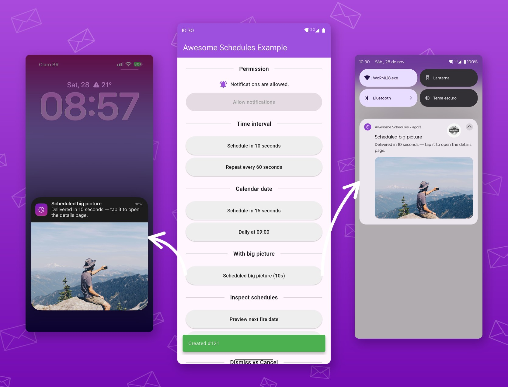

#  awesome_notifications_schedules


[](#)
[](#)
[](https://discord.awesome-notifications.carda.me)

[](#)
[](https://pub.dev/packages/awesome_notifications_schedules)


Notification scheduling for [awesome_notifications](https://pub.dev/packages/awesome_notifications).

Deliver notifications later — by a time interval or a calendar date, once or
repeating. Scheduling is attached to a normal `createNotification` call through
the `extensions:` slot; the native decorator (installed automatically by this
package) intercepts the build and registers the delayed delivery. The core stays
scheduling‑agnostic.



*A big picture notification scheduled in the example app (center), delivered 10 seconds later
on the iOS lock screen (left) and in the Android notification shade (right).*

## Getting started

Add both the core and this decorator to your `pubspec.yaml`:

```yaml
dependencies:
  awesome_notifications: ^1.0.0-dev.1
  awesome_notifications_schedules: ^1.0.0-dev.1
```

## Usage

Schedule by passing a `NotificationInterval` or `NotificationCalendar` as an
extension to the core's `createNotification`:

```dart
import 'package:awesome_notifications/awesome_notifications.dart';
import 'package:awesome_notifications_schedules/awesome_notifications_schedules.dart';

// Fire in 10 seconds.
await AwesomeNotifications().createNotification(
  content: NotificationContent(id: 1, channelKey: 'basic', title: 'Hi'),
  extensions: [
    NotificationInterval(interval: const Duration(seconds: 10), allowWhileIdle: true),
  ],
);

// Fire every day at 09:00.
await AwesomeNotifications().createNotification(
  content: NotificationContent(id: 2, channelKey: 'basic', title: 'Daily'),
  extensions: [
    NotificationCalendar(hour: 9, minute: 0, second: 0, repeats: true),
  ],
);
```

Manage pending schedules through `AwesomeNotificationsSchedules()`:

```dart
final schedules = AwesomeNotificationsSchedules();

await schedules.getNextDate(NotificationCalendar(hour: 9)); // preview next fire
await schedules.listScheduledNotifications();
await schedules.cancelSchedule(1);
await schedules.cancelAllSchedules();
```

See the `example/` app for a runnable, single‑file demo.

## Platform support

| Feature | Android | iOS | macOS | Windows | Linux | Web |
|---|:-:|:-:|:-:|:-:|:-:|:-:|
| Interval and calendar schedules | ✅ | ✅ | ✅ | 🧪 | 🧪 | ❌ |
| List / cancel / `getNextDate` | ✅ | ✅ | ✅ | 🧪 | 🧪 | ❌ |
| Delivered while the app is closed | ✅ | ✅ | ✅ | 🧪 | ⏳ | ❌ |

✅ supported · 🧪 preview (implemented, still being validated against the 0.12 behavior) · ⏳ planned · ❌ not possible on this platform

- **Web:** browsers have no API to schedule a local notification (the
  Notification Triggers proposal was abandoned), and a page's timers stop when
  the tab closes. So this package does not declare web support. To notify a web
  user later, send a push from your server at the right time.
- **Linux** has no system scheduler for notifications, so the app keeps its
  schedules (saved to disk) and shows them with its own timer while it runs.
  Occurrences that came due while the app was closed are shown as soon as it
  starts again (the latest one per notification). Delivery with the app closed
  is planned through a small helper bundled with the app.
- **Where scheduling is not available** (web),
  `AwesomeNotificationsSchedules.isPlatformSupported` is `false`. The
  management calls answer "nothing scheduled" (no-op, an empty list, `null`)
  instead of throwing. A `createNotification` carrying a schedule answers
  `false`, so the notification is never shown immediately by mistake.
- Where Android and iOS behave differently, macOS follows iOS and Windows
  follows Android.
